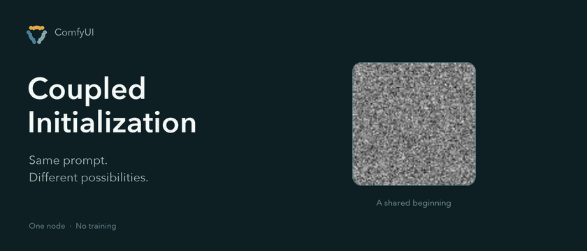

<div align="center">



**More diversity. Same cost. One node.**

[](LICENSE)
[](pyproject.toml)
[](https://arxiv.org/abs/2605.11311)
[](https://proceedings.iclr.cc/paper_files/paper/2026/file/20b6b87ca17792337f414d948af7b0e8-Paper-Conference.pdf)

[Install](#install) · [Use it](#use-it) · [Workflows](#example-workflows) · [How it works](#how-it-works) · [Papers](#paper--citation) · [中文](README.zh-CN.md)

</div>

---

**Coupled Initialization** increases batch diversity without increasing generation cost.
Add one node to your existing workflow, with no training or extra dependencies.

The [example workflows](#example-workflows) compare independent and coupled noise with the
same prompt, seed and sampling settings.

### Independent noise vs. Coupled Initialization

SD1.5 FP16 · 512×512 · K = 2 · seed 538271 · CFG 7 · Euler/Karras · 28 steps · strength 1.

Prompt: *A magical library carved inside an ancient giant tree…* Coupling produces a different
archway composition while preserving the tree library theme.

| Independent Initialization | Coupled Initialization |
| :---: | :---: |
|  <br><sub>Shared reference → second candidate</sub> |  <br><sub>Shared reference → second candidate</sub> |

The starting noise pair's mean squared distance is **2.01 with independent noise and
3.96 with coupling (1.97×)**. At K = 2 and strength 1, coupling doubles the expected squared distance.

## Install

Link the plugin folder into `ComfyUI/custom_nodes`:

```bash
ln -s /path/to/ComfyUI-CoupledInitialization ComfyUI/custom_nodes/ComfyUI-CoupledInitialization
```

Restart ComfyUI. There are no Python dependencies.

## Use it

Add **Coupled Initialization** (`sampling → custom_sampling → noise`), connect its **noise** output
to **SamplerCustomAdvanced → noise** in place of `RandomNoise`, and set the empty latent's
**batch_size** to K.

| Input | Range | Default | What it does |
| --- | --- | --- | --- |
| `seed` | 0 to 2⁶⁴−1 | `0` | Seed for the whole batch. Keep it fixed when comparing against IID. |
| `strength` | 0.0 to 1.0 | `1.0` | `0` reproduces native IID noise exactly; `1` is maximum repulsion. |
| **K** | ≥ 1 | From latent | K is the latent's `batch_size`. Start with 2 or 3; K = 1 uses native noise. |

At **K = 2, strength = 1** the pair is exactly `(ε, −ε)`, the
antithetic noise of our ICLR 2026 paper,
[Antithetic Noise in Diffusion Models](https://arxiv.org/abs/2506.06185).

## Example workflows

| Model | Sampling settings | K = 2 | K = 3 |
| --- | --- | --- | --- |
| **SD1.5** | CFG 7, karras, 28 steps, 512×512 | [Workflow](examples/sd15_k2_comparison.json) | |
| **SDXL** | CFG 3, karras, 30 steps | [Workflow](examples/sdxl_k2_comparison.json) | [Workflow](examples/sdxl_k3_comparison.json) |
| **FLUX.1-schnell** | BasicGuider, simple, 4 steps | [Workflow](examples/flux_schnell_k2_comparison.json) | [Workflow](examples/flux_schnell_k3_comparison.json) |

Each workflow compares Coupled Initialization with native `RandomNoise`. Both branches share the
same prompt, guider, sampler, sigmas and latent.

The SD1.5 workflow uses Comfy-Org's [FP16 checkpoint](https://huggingface.co/Comfy-Org/stable-diffusion-v1-5-archive/blob/main/v1-5-pruned-emaonly-fp16.safetensors). Place it in `models/checkpoints` before loading the workflow.

## How it works


Coupled Initialization transforms the batch's initial noise so that any two samples have
correlation `ρ = −strength / (K − 1)`. At `strength = 1`, this is the most negative correlation
possible for K jointly Gaussian variables. Each sample retains a standard Gaussian marginal;
coupling changes the batch's joint distribution.

<details>
<summary>Compatibility</summary>

<br>

* Models: diffusion and flow models initialized with standard Gaussian noise.
* Sampling interface: `SamplerCustomAdvanced` and other nodes that consume a `NOISE` object.
* Latents: image latents shaped `[batch, channels, height, width]`.
* Precision: half precision batches are reduced in float32; float64 inputs keep double precision.
* Batch indices: use distinct `batch_index` values or a fresh empty latent. Set `strength = 0` to use native noise.

</details>

## Paper & citation

Coupled Initialization builds on two papers:

* [Couple to Control: Joint Initial Noise Design in Diffusion Models](https://arxiv.org/abs/2605.11311).
  [Jing Jia](https://jjia131.github.io/), [Liyue Shen](https://liyueshen.engin.umich.edu/) and [Guanyang Wang](https://guanyangwang.github.io/). arXiv, 2026.
* [Antithetic Noise in Diffusion Models](https://arxiv.org/abs/2506.06185).
  [Jing Jia](https://jjia131.github.io/), [Sifan Liu](https://liusf15.github.io/), [Bowen Song](https://efzero.github.io/), [Wei Yuan](https://statistics.rutgers.edu/people-pages/graduate-students/graduate-student-detail/167-fourth-year/624-wei-yuan), [Liyue Shen](https://liyueshen.engin.umich.edu/) and [Guanyang Wang](https://guanyangwang.github.io/). ICLR 2026.

Please cite both papers if you use Coupled Initialization in research.

<details>
<summary>BibTeX</summary>

```bibtex
@misc{jia2026couplecontrol,
  title={Couple to Control: Joint Initial Noise Design in Diffusion Models},
  author={Jing Jia and Liyue Shen and Guanyang Wang},
  year={2026},
  eprint={2605.11311},
  archivePrefix={arXiv},
  primaryClass={cs.LG},
  url={https://arxiv.org/abs/2605.11311}
}

@inproceedings{jia2026antithetic,
  title={Antithetic Noise in Diffusion Models},
  author={Jing Jia and Sifan Liu and Bowen Song and Wei Yuan and Liyue Shen and Guanyang Wang},
  booktitle={International Conference on Learning Representations},
  year={2026},
  url={https://proceedings.iclr.cc/paper_files/paper/2026/file/20b6b87ca17792337f414d948af7b0e8-Paper-Conference.pdf}
}
```

</details>

<div align="center">

[MIT license](LICENSE) · [Citation metadata](CITATION.cff) · [中文说明](README.zh-CN.md)

</div>
