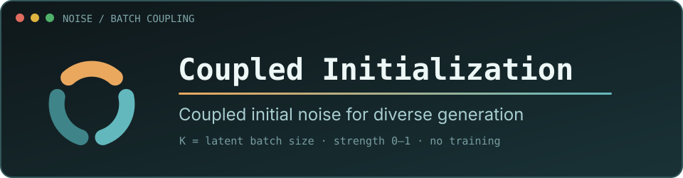
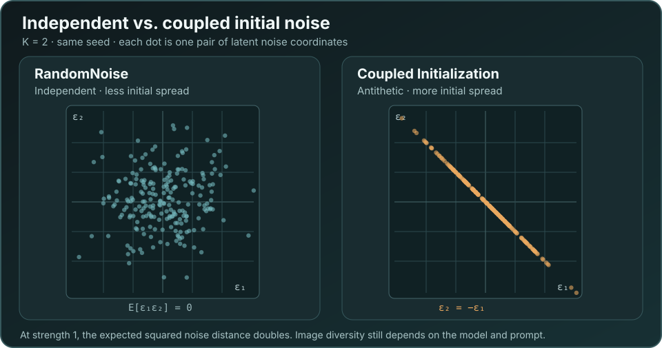

<div align="center">



**一个节点，让现有模型探索更多样的结果。无需训练。**

[](LICENSE)
[](pyproject.toml)
[](https://arxiv.org/abs/2605.11311)
[](https://proceedings.iclr.cc/paper_files/paper/2026/file/20b6b87ca17792337f414d948af7b0e8-Paper-Conference.pdf)

[安装](#安装) · [使用](#使用) · [工作流](#示例工作流) · [原理](#原理) · [论文](#论文与引用) · [English](README.md)

</div>

---

**Coupled Initialization** 通过耦合一组初始噪声，让同样的模型、prompt 和采样步数探索到更多样的
候选结果——图片数量不变、开销不变。它适用于任何以标准高斯噪声开始生成的 diffusion 或 flow
模型，无需重新训练、无需增加去噪次数、不引入任何依赖。

[示例工作流](#示例工作流)使用相同的 prompt、seed、sampler 和 latent，对比原生 IID 噪声与耦合噪声。
两条分支的第一份初始噪声完全相同；GPU 推理仍可能带来细微的像素差异。

### 独立噪声与耦合噪声对比

SD1.5 FP16 · 512×512 · K = 2 · seed 538271 · CFG 7 · Euler/Karras · 28 步 · strength 1。
Prompt：*一座建在古树里的奇幻图书馆……* 两条分支的第一份初始噪声相同。这次生成中，耦合分支
探索了另一种拱廊构图，同时保留了树中图书馆的主题。

| RandomNoise：起始噪声对的差异较小 | Coupled Initialization：起始噪声对的差异较大 |
| :---: | :---: |
|  <br><sub>共同参考图 → 第二张候选图</sub> |  <br><sub>共同参考图 → 第二张候选图</sub> |

这个 seed 下，两份初始噪声的平均平方距离从独立噪声的 **2.01** 增加到耦合噪声的 **3.96（1.97 倍）**。
K = 2 且 strength = 1 时，理论上的*预期*平方距离翻倍。成图的多样性仍随 prompt 和模型变化；这里只展示一次生成的结果。

## 安装

本地使用时，把插件目录链接到 `ComfyUI/custom_nodes`：

```bash
ln -s /path/to/ComfyUI-CoupledInitialization ComfyUI/custom_nodes/ComfyUI-CoupledInitialization
```

之后重启 ComfyUI 即可，没有任何 Python 依赖。

## 使用

添加 **Coupled Initialization** 节点（菜单路径 `sampling → custom_sampling → noise`），把它的
**noise** 输出接到 **SamplerCustomAdvanced → noise**，替换掉原来的 `RandomNoise`，再把
empty latent 的 **batch_size** 设为 K。

| 输入 | 取值范围 | 默认值 | 说明 |
| --- | --- | --- | --- |
| `seed` | 0 – 2⁶⁴−1 | `0` | 整组图片的种子。与 IID 对比时保持固定。 |
| `strength` | 0.0 – 1.0 | `1.0` | `0` 完全复现原生 IID 噪声；`1` 为最大排斥。 |
| **K** | ≥ 1 | — | 不是节点上的控件：K 来自 latent 的 `batch_size`。建议先试 2 或 3；K = 1 使用原生噪声。 |

batch 中的第一份噪声始终不动，因此第一张图可作为原生噪声的对照参考；GPU 推理可能带来细微的像素差异。
当 **K = 2 且 strength = 1** 时，这一对正好是 `(ε, −ε)`，即我们 ICLR 2026 论文
[Antithetic Noise in Diffusion Models](https://arxiv.org/abs/2506.06185) 研究的 antithetic noise。

## 示例工作流

| 模型 | 采样设置 | K = 2 | K = 3 |
| --- | --- | --- | --- |
| **SD1.5** | CFG 7、karras、28 步、512×512 | [工作流](examples/sd15_k2_comparison.json) | — |
| **SDXL** | CFG 3、karras、30 步 | [工作流](examples/sdxl_k2_comparison.json) | [工作流](examples/sdxl_k3_comparison.json) |
| **FLUX.1-schnell** | BasicGuider、simple、4 步 | [工作流](examples/flux_schnell_k2_comparison.json) | [工作流](examples/flux_schnell_k3_comparison.json) |

每个工作流都会把 prompt 渲染两遍——一条 Coupled Initialization 分支和一条原生 `RandomNoise` 分支，共用同一个
guider、sampler、sigmas 和 latent，因此唯一的变量就是噪声。

SD1.5 工作流使用 Comfy-Org 的 [FP16 checkpoint](https://huggingface.co/Comfy-Org/stable-diffusion-v1-5-archive/blob/main/v1-5-pruned-emaonly-fp16.safetensors)。导入工作流前，请把模型文件放进 `models/checkpoints`。

## 原理



Coupled Initialization 先按 ComfyUI 原本的方式取得整个 batch 的噪声，再沿 batch 维做一次线性变换，使任意两份
噪声之间的相关系数为 `ρ = −strength / (K − 1)`。当 `strength = 1` 时，这已是 K 个联合高斯变量
所能达到的最负相关。每份噪声仍保持标准高斯边缘分布，所以模型看到的输入分布没有改变，改变的
只是这一组噪声的*联合*分布。

<details>
<summary>兼容性与限制</summary>

<br>

- 采样接口：`SamplerCustomAdvanced`，以及其他接收 `NOISE` 对象的节点。
- 张量格式：形状为 `[batch, channels, height, width]` 的图像 latent。v0.1 暂不支持视频和 nested latent。
- 精度：半精度 batch 的归约在 float32 下进行；float64 输入保留双精度。
- 若 latent 中的 `batch_index` 有重复，就没有互不相同的基础噪声可供排斥，此时节点会直接报错而不是
  悄悄失效。请新建一个 empty latent，或把 `strength` 设为 0。

</details>

## 论文与引用

本插件基于 [Couple to Control: Joint Initial Noise Design in Diffusion Models](https://arxiv.org/abs/2605.11311)，
作者为 [Jing Jia](https://jjia131.github.io/)、[Liyue Shen](https://liyueshen.engin.umich.edu/)
和 [Guanyang Wang](https://guanyangwang.github.io/)。科研使用请引用以下两篇论文。

<details>
<summary>BibTeX</summary>

```bibtex
@misc{jia2026couplecontrol,
  title={Couple to Control: Joint Initial Noise Design in Diffusion Models},
  author={Jing Jia and Liyue Shen and Guanyang Wang},
  year={2026},
  eprint={2605.11311},
  archivePrefix={arXiv},
  primaryClass={cs.LG},
  url={https://arxiv.org/abs/2605.11311}
}

@inproceedings{jia2026antithetic,
  title={Antithetic Noise in Diffusion Models},
  author={Jing Jia and Sifan Liu and Bowen Song and Wei Yuan and Liyue Shen and Guanyang Wang},
  booktitle={International Conference on Learning Representations},
  year={2026},
  url={https://proceedings.iclr.cc/paper_files/paper/2026/file/20b6b87ca17792337f414d948af7b0e8-Paper-Conference.pdf}
}
```

</details>

<div align="center">

[MIT 许可证](LICENSE) · [引用元数据](CITATION.cff) · [English](README.md)

</div>
